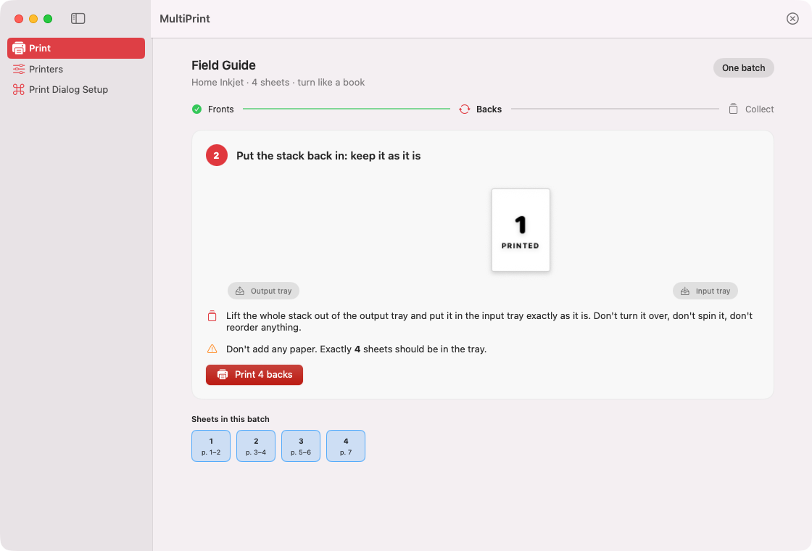
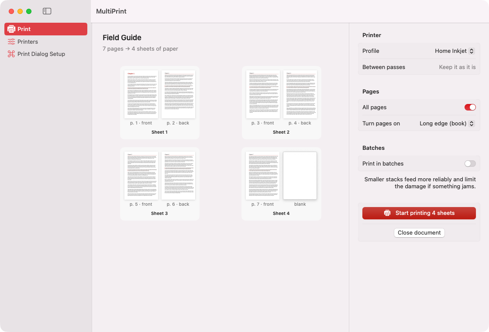
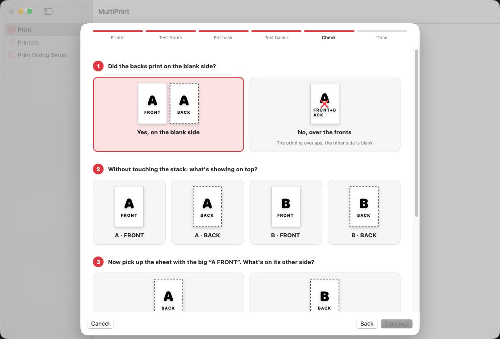
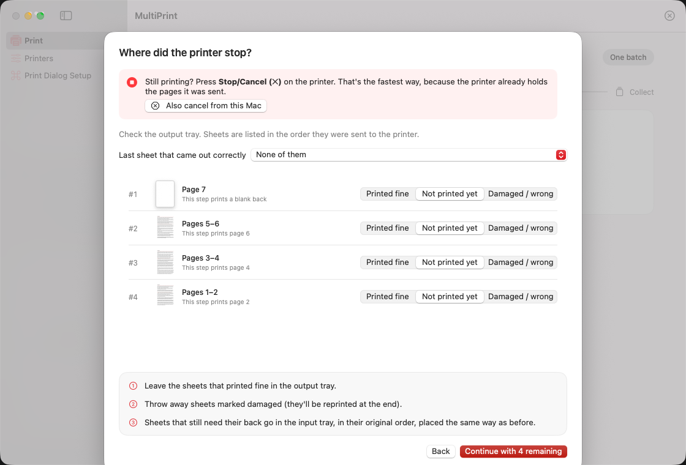
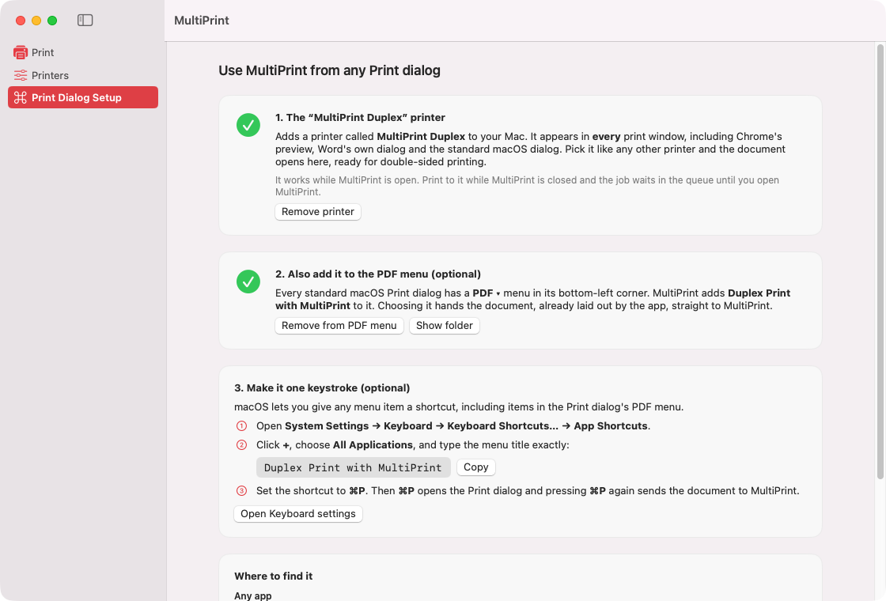

<p align="center">
  
</p>

<h1 align="center">MultiPrint</h1>

<p align="center">
  <b>Double-sided printing on printers that can't do it themselves, for macOS.</b><br>
  Calibrate your printer once with two sheets of paper. After that, MultiPrint sends every page in the right
  order and rotation, and tells you exactly how to put the stack back in.
</p>

<p align="center">
  <a href="https://github.com/ishaanpilar/MultiPrint/releases/latest"></a>
  
  
  <a href="LICENSE"></a>
</p>

## Why

Printing double-sided on a printer without a duplex unit means printing the fronts, putting the stack back in, and
printing the backs. Every printer handles that differently: which side it prints on, whether pages come out face up
or face down, whether the driver reverses the order. Every app's print dialog handles odd and even pages differently
too. So pages end up upside down, on the wrong sheet, or printed over the fronts.

MultiPrint doesn't guess. A two-sheet test print measures how *your* printer behaves, and every job after that is
planned around it.

## Features

- **Calibration wizard:** print a big **A** and **B**, put them back, print the backs, and answer four questions by
  clicking pictures. If the backs land on the printed side, the wizard tells you and switches to the other way of
  reloading the stack.
- **Step-by-step printing:** load N sheets → print fronts → an animation of how to move the stack → print backs →
  collect. Long jobs can run in batches.
- **Your own photos:** attach photos of how *you* load paper and move the stack, and see them at each step.
- **Recovery when the printer stops:** mark each sheet as printed, not printed or damaged. MultiPrint resends only
  what's missing, reprints damaged sheets at the end, tells you where they go, and can cancel the job on the
  printer itself.
- **Works from every app:** adds a **MultiPrint Duplex** printer that appears in every print window, including
  Chrome's preview and Word's own dialog.
- **Opens almost anything:** PDF, images (JPEG, PNG, HEIC, TIFF, GIF, BMP, WebP), Word, Excel, PowerPoint and
  OpenDocument (through LibreOffice), RTF, HTML, text, Markdown and CSV. Several files become one document.

## Screenshots

| Pick a document | Calibrate your printer |
| --- | --- |
|  |  |
| **When the printer stops** | **Use it from any app** |
|  |  |

## Install

1. Download `MultiPrint-<version>.zip` from the [latest release](https://github.com/ishaanpilar/MultiPrint/releases/latest),
   unzip it and move **MultiPrint.app** to your Applications folder.
2. The app isn't notarized by Apple, so the first launch is blocked. Open **System Settings → Privacy & Security**
   and click **Open Anyway** next to MultiPrint. You can also run this once in Terminal:
   ```sh
   xattr -dr com.apple.quarantine /Applications/MultiPrint.app
   ```
3. In MultiPrint, open **Print Dialog Setup → Add printer**.
4. Go to **Printers → Calibrate a printer…** and run the two-sheet test.

Requires macOS 14 or later, on Apple silicon or Intel. For Excel and PowerPoint files, install
[LibreOffice](https://www.libreoffice.org) (Word files also open without it, with simpler layout).

### Build from source

```sh
git clone https://github.com/ishaanpilar/MultiPrint.git
cd MultiPrint
swift test                        # planner, calibration, printer simulation, IPP
./scripts/build-app.sh --install  # builds MultiPrint.app into ~/Applications
./scripts/build-app.sh --release  # universal build, zipped into build/
```

Needs Xcode 16 or later (developed with Xcode 27).

## Using it

1. **Calibrate** once per printer (**Printers → Calibrate a printer…**). Use the same way of putting the stack back
   every time after that.
2. **Print** from any app: press ⌘P, choose **MultiPrint Duplex** as the printer, and click Print. Or drop files on
   the MultiPrint window.
3. **Follow the cards.** Load the number of sheets shown, print the fronts, move the stack as the animation shows,
   print the backs, and collect. If your printer needs it, the last step tells you to turn the finished stack over.
   Do it in one go, without reshuffling.
4. **If the printer stops or misfeeds**, click *Printer stopped or something went wrong…*. If it's still printing,
   press Stop/Cancel on the printer first; pages already sent to it can only be stopped there.

## How it works

### Why there's no physics model

Whether a printer prints the up or down face, outputs face up or down, reverses jobs in the driver, or turns the
paper around in a U-path doesn't need to be modelled. Every one of those behaviours boils down to four facts,
measured relative to the order MultiPrint *sends* pages:

| Profile flag | Measured by |
| --- | --- |
| `reloadMethod` (keep as is / turn over) | Did the backs print on the blank side? |
| `backsReversed` | Which back ended up on sheet A? |
| `backsRotated` | Is the back's arrow upside down when you turn sheet A like a book page? |
| `frontsReversed`, `turnFinishedStackOver` | What's on top of the finished stack? |

### Planning a job

`DuplexPlanner` pairs pages into sheets (1/2, 3/4, …) and gives an odd last page a blank back, so every sheet in
the stack gets something in pass 2. For each batch:

- **Fronts**: each sheet's front page, sent last-to-first if `frontsReversed`.
- **Backs**: the sheets still in the stack in front-send order, reversed if `backsReversed`, each back rotated by
  `backsRotated XOR (binding == short edge)`.

Every pass is turned into a new PDF (PDFKit) and sent with
`lp -o sides=one-sided -o outputorder=normal`. MultiPrint never relies on `page-set=odd/even` or on a driver's
reverse-order setting, because those behave differently on every printer and in every app. That inconsistency is
exactly what caused the original confusion.

### Resume rules (`DuplexJob.applyReport`)

- Printed fine → done.
- Damaged → taken out of the batch and reprinted at the end (front and back), with instructions for where to put it.
- Not printed *after* the last good sheet → sent again; the paper order is still intact.
- Not printed *before* a good sheet (for example a double feed) → can't be slotted back in order, so it's reprinted at the end too.

### Verification

`Tests/MultiPrintCoreTests/PrinterSimulation.swift` simulates a paper path with 5 independent behaviours
(32 printers). For each one it answers the wizard's questions by "looking at" the simulated paper, then prints
1–7 page documents with both bindings, in one batch and in batches of 2, and checks every sheet's front, back
and orientation. `IPPTests.swift` covers the virtual printer's protocol handling, including chunked uploads.

## Print-dialog integration

### The "MultiPrint Duplex" printer (works in every app)

**Print Dialog Setup → Add printer** runs `lpadmin` to register a CUPS queue `MultiPrint_Duplex`. It points at
`ipp://127.0.0.1:8631/ipp/print`, uses a generated pass-through PDF printer description, and isn't shared on the
network. While MultiPrint is open, it runs a tiny IPP server on loopback (`VirtualPrinterServer.swift`,
`MultiPrintCore/IPP.swift`). CUPS sends it each job's PDF, which lands in the inbox and opens in the app.

Because it's a real printer queue, it appears in the standard macOS dialog, Chrome's own preview and Office's own
print window. If you print to it while MultiPrint is closed, the job waits in the queue and arrives when you open
MultiPrint. Making it work with the app closed would need a login item or launch agent, which isn't installed.

### PDF menu (optional)

macOS shows everything in `~/Library/PDF Services` in the Print dialog's **PDF ▾** menu. MultiPrint installs a
Finder alias to itself there. Picking it makes macOS render the document to PDF and open it in MultiPrint, which
copies it immediately because the spooled file is temporary.

- To make it one keystroke, go to System Settings → Keyboard → Keyboard Shortcuts → App Shortcuts → All
  Applications, add the title `Duplex Print with MultiPrint` and set it to ⌘P. Then ⌘P ⌘P sends any document
  to MultiPrint.
- Chrome-based browsers: use *Print using system dialog…* (⌥⌘P).
- Office for Mac: use the system dialog if offered, otherwise Save As PDF and drop it in.

## Project layout

```
Sources/MultiPrintCore/   pure logic: models, DuplexPlanner, Calibration, DuplexJob (state + resume), IPP codec
Sources/MultiPrint/       SwiftUI app: AppModel, Services (CUPS, PDFKit, conversion, virtual printer), Views
Tests/                    unit tests, printer simulation, IPP tests
Support/Info.plist        bundle metadata (opens supported documents as an alternate handler)
scripts/build-app.sh      builds, installs or packages MultiPrint.app
```

The app stores its data in `~/Library/Application Support/MultiPrint`: printer profiles, the current job (so it
survives a restart), document copies and your photos.

Debug builds accept a few launch arguments for development, for example
`-storageRoot /tmp/mp -previewWizardStep 4`. They open a screen directly, using a separate data folder.

## Prior art

- [nclarius/automatic-manual-duplex-printing](https://github.com/nclarius/automatic-manual-duplex-printing): shell
  script, odd/even jobs through `lp`.
- [pdf-duplex-prep](https://pypi.org/project/pdf-duplex-prep/): writes odd pages and reversed even pages as two
  PDFs and adds a blank page for odd counts.
- [stjomd/printds](https://github.com/stjomd/printds): Swift CLI for macOS, prompts between the two halves.
- [opensource.com Bash script](https://opensource.com/article/20/4/print-duplex-bash-script): `page-set=odd|even`
  and `outputorder=reverse`.

All of these hard-code one printer's behaviour (usually "even pages reversed"). MultiPrint measures it instead,
and adds resume and reprint on top.

## License

[MIT](LICENSE) © 2026 Ishaan Pilar
